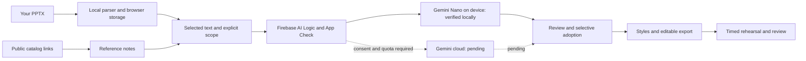

# ShowFlow

**From your pitch deck to a presentation you can deliver.**

ShowFlow helps founders import their own PowerPoint, find comparable public decks, review AI edits, restyle editable slides, and rehearse with a real timer. The original file and previous versions stay in the browser.

[Open the judging preview](https://showflow-hybrid-ai.bambi2005star.chatgpt.site) · [Testing guide](docs/JUDGING.md) · [English sample](public/samples/ShowFlow_English_Sample.pptx) · [Previous device run](public/evidence/on-device-run.json)

> Work in progress for #BuildHybridAI 2026. The hosted preview currently provides import, live catalog discovery, styling, PPTX export and rehearsal. Live AI in that hosted preview is not active. Real Firebase device inference was verified locally. Cloud output and fallback await quota; exact Nano 4 identity remains unconfirmed. This is not yet the final competition submission.

## Try the public preview

No account or payment is needed for the non-AI workflow. Use desktop Chrome, open **Reviewer guide**, then **Try English sample**. The two-slide synthetic deck contains no customer information. Existing projects are kept as browser-local versions when the sample is loaded.

1. Collect references with `team collaboration SaaS pitch deck`. The app fetches a live public catalog and matches metadata locally. It does not read or redistribute entire third-party decks.
2. In **Styles**, select a global theme, change one slide, and export an editable `.pptx`.
3. In **Director**, inspect the sequence and notes. Start rehearsal, pause, mark a slide, advance, then finish and review timings.
4. Download cue cards or retrieve the original imported file. Projects persist in this browser; rehearsal sessions are currently session-only.

## Run real AI locally

Use Node.js 20.19+ or 22.12+ and a supported desktop Chrome environment.

```sh
npm ci
npm run build
npm test
npm start
```

Open `http://localhost:4173/`. Import your own PPTX or load the bundled English sample.

For Firebase AI:

1. Create your own Firebase web app and enable Firebase AI Logic with the Gemini Developer API. Configure and enforce App Check.
2. Copy `firebase.config.example.json` to `.runtime/firebase.local.json`, fill in your own configuration and a registered App Check debug credential, and restrict the file to its owner. Never commit this file or share the debug credential.
3. Restart the app. In **Project**, click **Prepare device model**, then **Verify App Check**.
4. Select **Device only** and English. Review the selected text and consent for this request, then generate. Compare both versions and selectively adopt changes.

Do not use local debug credentials on a public deployment. Production activation needs an appropriate attestation provider and separately configured Firebase project. No live project credentials are included in this repository. The public preview has no secret-bearing setup endpoint.

## Firebase at runtime

`src/firebase-ai.js` imports and actually calls the official `firebase/ai` SDK:

- `getAI` with `GoogleAIBackend` and `getGenerativeModel`.
- `ONLY_ON_DEVICE` for private editing of English input.
- Explicitly consented `PREFER_ON_DEVICE` and `ONLY_IN_CLOUD` modes, implemented but still awaiting successful cloud validation.
- `generateContent`, App Check token exchange, and `response.inferenceSource` tracing.



Original PPTX bytes and images are never sent to the model by this implementation. Speaker notes are excluded by default. Public catalog searches fetch the catalog, not slide content. Any model can produce weak wording or inaccurate claims: numeric/status checks do not replace human review. On-device setup and App Check can still require network access; full offline loading is untested.

## Evidence and limits

The sanitized historical run in `public/evidence/on-device-run.json` records two genuine `ON_DEVICE` responses with verified App Check on November 17, 2026. One suggestion was adopted; the other was rejected because its wording added unsupported implications. It is explicitly a previous local run, not output generated by the public preview.

The original free Spark project's real cloud request returned a free-tier eligibility HTTP 403. A hackathon temporary-account request was submitted; approval and account issuance remain pending. No billing upgrade was made. New quota will be validated separately before enabling hosted AI or claiming device-to-cloud handoff.

English and Simplified Chinese interfaces are supported. Device editing currently supports English text, requests and borrowing notes. Some generated sample raster assets contain Chinese text; loading the English sample gives an English content path. PPTX parsing is a content preview and may differ from native PowerPoint in fonts, masters, diagrams and animations. Originals are preserved separately. Exact Nano 4 model identity is not exposed by the current SDK trace and still needs independent confirmation.

## Project and validation

- `src/`: React UI, browser PPTX import/export, Firebase policy and inference.
- `server/`: loopback-only private Firebase setup and optional legacy local-model API.
- `worker/`: preserved static Sites adapter; it never exposes the private Node setup API.
- `public/`: generated demo artwork, synthetic sample, reviewer guide and sanitized evidence.
- `tests/`: meaningful checks for import, export, catalog matching, consent, guarded facts, provenance and hosting behavior.

Run `npm run build && npm test`. The existing Sites handoff also supports `npm run test:sites`. Unit tests include injected model responses and do not prove actual device or cloud inference. See [JUDGING.md](docs/JUDGING.md) for live acceptance steps.

This project was built during November 15–17, 2026, after the contest opened. It uses standard open-source packages and AI coding assistance. UI artwork was generated with OpenAI image generation and adapted into synthetic demo assets. Optional legacy Ollama/OpenAI paths are separate from Firebase and are not presented as Firebase eligibility evidence. See [THIRD_PARTY.md](THIRD_PARTY.md) for attribution and [SUBMISSION.md](docs/SUBMISSION.md) for the English submission draft.

## License

Apache License 2.0 for the original ShowFlow source and included synthetic demonstration materials. Third-party packages, linked decks and external catalog content retain their respective rights. No third-party pitch deck files are redistributed.
